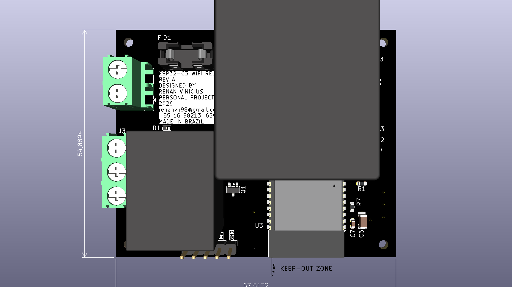
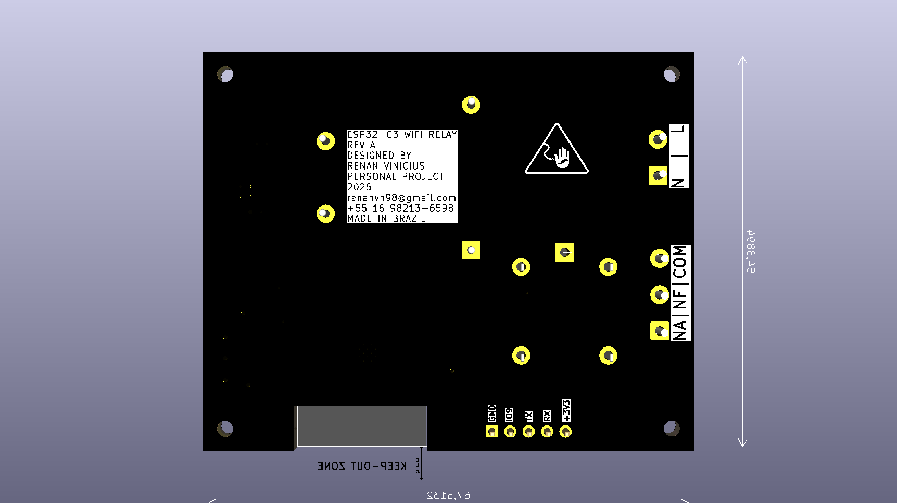
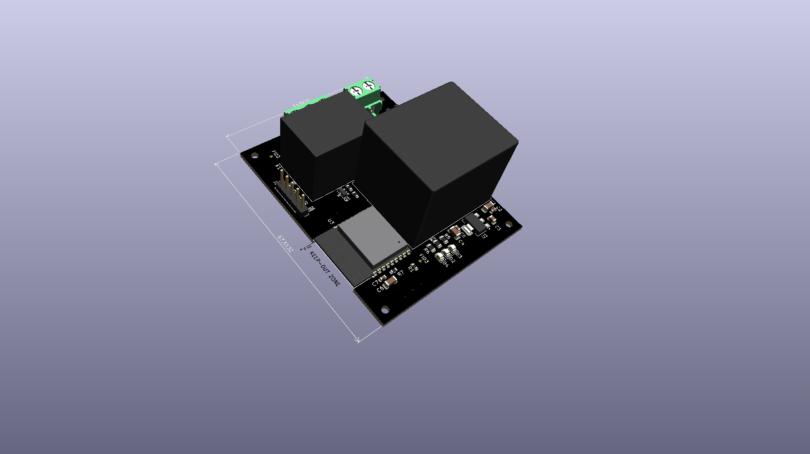

# Smart Switch PCB — ESP32-C3

Placa de circuito impresso para interruptor inteligente de parede, desenvolvida com o ESP32-C3 para automação residencial via Wi-Fi.

## Visualização da PCB

### Vista 3D principal

### Vista 3D — detalhe 1

### Vista 3D — detalhe 2

## Especificações técnicas

- **Microcontrolador:** ESP32-C3-WROOM-02
- **Alimentação:** módulo AC-DC HS-40012, entrada 127/220 V AC e saída de 12 V DC
- **Regulação lógica:** AZ1117CH-3.3, saída de 3,3 V
- **Relé:** SRD-12VDC-SL-C
- **Acionamento:** MOSFET canal N
- **Programação:** interface UART de 4 pinos
- **Aplicação:** automação residencial e controle de cargas elétricas

## Arquivos do projeto

| Arquivo | Descrição |
|---|---|
| `fonte_rele_esp-c3.kicad_pro` | Projeto KiCad |
| `fonte_rele_esp-c3.kicad_sch` | Esquemático elétrico |
| `fonte_rele_esp-c3.kicad_pcb` | Layout da placa |
| `images/` | Renderizações 3D da PCB |

## Observações de hardware

O contato COM do relé é disponibilizado separadamente do terminal de entrada de fase da placa. A ligação externa deve ser feita somente após verificar o esquema elétrico e as condições de segurança da instalação.

**Atenção:** a placa envolve tensão de rede elétrica. A separação entre alta e baixa tensão, o dimensionamento das trilhas, a proteção por fusível e as distâncias de isolamento devem ser validados antes da fabricação e utilização.

## English

Smart wall-switch PCB based on the ESP32-C3 for Wi-Fi home automation. The design integrates AC-DC power conversion, 3.3 V logic regulation, relay control and UART programming.

The repository contains the KiCad project, electrical schematic, PCB layout and 3D board renders.
